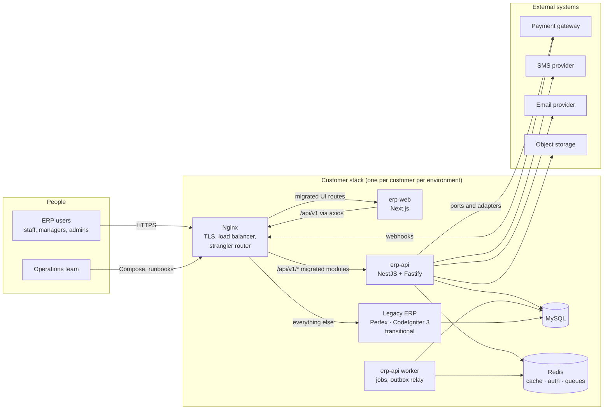

# System context (C4 level 1)

The ERP serves one customer per deployment. During the migration, two systems share the database behind one Nginx entry point. After the last module is cut over, the legacy box disappears and nothing else changes.

## Actors

| Actor | Interaction |
|---|---|
| ERP users | Use the web application. During coexistence they do not know which system serves a screen; the login page is served by Next.js from the first wave. |
| Operations team | Deploys with Docker Compose per customer and environment from `erp-infra`, runs backups and runbooks. |
| External systems | Reached only through the integration layer (ports and adapters) in `erp-api`; inbound webhooks enter through Nginx to `/api/v1/webhooks/:provider`. |

## Boundaries

- One customer stack contains everything for that customer: no shared database or Redis between customers.
- Nginx is the only public entry. `web`, `api`, `worker`, `mysql`, and `redis` sit on a private Compose network.
- The legacy system (Perfex on CodeIgniter 3) is a temporary container in the same stack. It joins the stack at wave minus one. Removing it after the last cutover is a Compose change and a Nginx routing change (see `05-strangler-fig-migration.md`).

## What this diagram does not show

Environments (`local`, `dev`, `uat`, `prod`) are copies of the same shape with different env files. Monitoring is a separate `erp-ops` Compose project (not decided yet).
