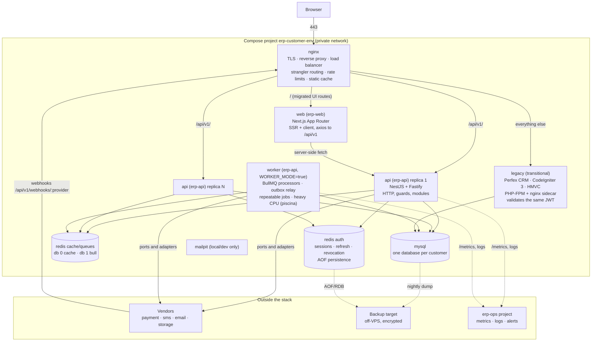

# Containers (C4 level 2)

One customer stack, one environment. Every box is a container in the Compose project `erp-<customer>-<env>`. The `legacy` container exists only until the last module is cut over. It holds the existing Perfex CRM on CodeIgniter 3 and arrives in the stack at wave minus one.

## Responsibilities

| Container | Image / source | Owns | Never does |
|---|---|---|---|
| nginx | `erp-infra/nginx` templates rendered per customer | TLS termination, HTTP to HTTPS, upstream load balancing across `api` replicas, the strangler `location` map, rate limiting, security headers, gzip/brotli, static asset caching, webhook raw-body pass-through | Business logic, authentication decisions (it forwards the `Authorization` header untouched) |
| web | `erp-web` image tagged by git SHA | Rendering, routing, client cache (SWR), form handling, calling the API through the same Nginx origin | Talking to MySQL or Redis, holding secrets other than its own public config |
| api | `erp-api` image, `N` replicas (config) | HTTP API `/api/v1`, guards and permissions, validation, transactions, outbox writes, cache tiers, emitting events, enqueueing jobs, issuing tokens | Long-running work (anything above the event-loop budget goes to `worker`), repeatable jobs |
| worker | same `erp-api` image with `WORKER_MODE=true` | BullMQ processors, the outbox relay, repeatable (cron) jobs with Redis locks, CPU-heavy tasks in a `piscina` pool, DLQ handling | Serving HTTP (only `/health` and `/metrics`) |
| legacy | existing Perfex/CI3 tree containerised at wave minus one, transitional | Modules not yet migrated; validates the RS256 JWT with the public key | Issuing tokens (its own HS256 API is switched off at wave 0), writing to Node-owned tables, receiving Perfex product upgrades during coexistence |
| mysql | official image, per customer | The single shared database during coexistence, one writer per table (see `05-strangler-fig-migration.md`) | Being shared between customers |
| redis cache/queues | official image, per customer | L2 cache (db 0), BullMQ queues and locks (db 1), rate-limit counters, pub/sub for L1 invalidation | Sessions or anything that must survive a `FLUSHDB` |
| redis auth | official image, per customer, AOF on | Refresh token hashes, session registry, revocation list, permission snapshots | Cache or queue data |
| mailpit | dev/local only | Catching outbound email | Existing in `uat` or `prod` (real adapters or sandbox adapters there) |

## Networking

- Only `nginx` publishes ports (80, 443). Every other container is reachable by service name on the Compose network only.
- `web` calls the API through Nginx (`https://<host>/api/v1`) from the browser, and directly by service name (`http://api:3000`) for server-side rendering, so cookies and the strangler routing behave the same in both paths.
- Replicas of `api` are stateless: no in-memory session, and the L1 cache is a performance layer that pub/sub keeps coherent.
- Blue/green: a second Compose project `erp-<customer>-<env>-blue` is started, health-checked, then the Nginx upstream is switched; the old project is stopped after the rollback window.

## Environment differences

| | local | dev | uat | prod |
|---|---|---|---|---|
| Vendor adapters | fake | fake | sandbox | live |
| TLS | mkcert | Let's Encrypt | Let's Encrypt | Let's Encrypt |
| api replicas | 1 | 1 | 2 | config |
| Bull Board, `/docs` (Swagger), `/admin/flags` | on | on | on | off |
| Log format | pretty console | JSON + file | JSON + file | JSON + file |
| Data | seed | seed | weekly restored prod backup | live |
