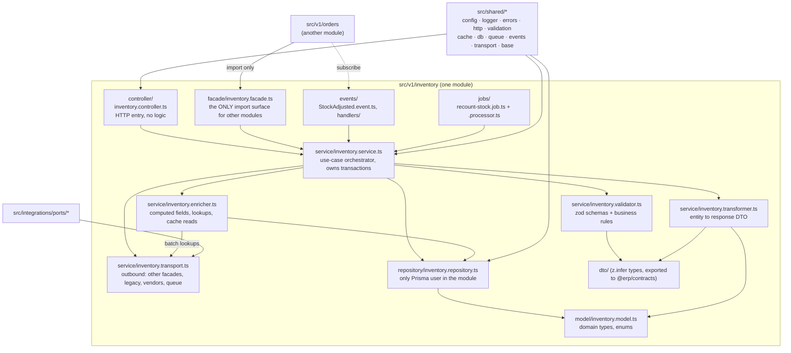
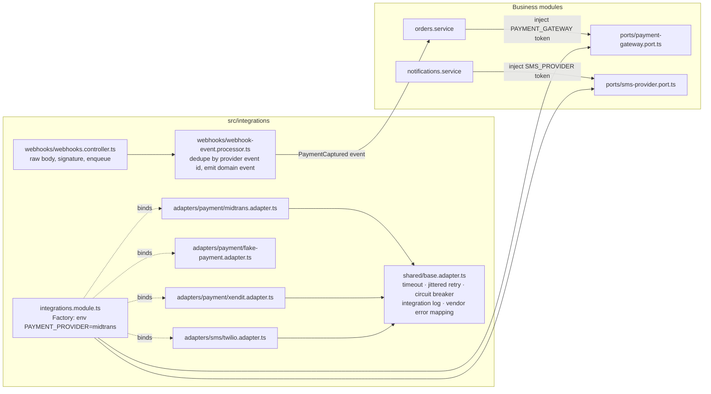

# Backend components (C4 level 3): the modular monolith

`erp-api` is one deployable made of bounded-context modules under `src/v1/<module>/`, generic cross-cutting code under `src/shared/`, and vendor adapters under `src/integrations/`. The rule that makes it "modular" rather than "a big app" is the import graph below: a module may reach another module only through that module's facade or through domain events.

## Module anatomy

### What each layer may do

| Layer | May import | Must not | Typical content |
|---|---|---|---|
| controller | service, dto, shared/http decorators | try/catch, business logic, repository, Prisma | route decorators from `<module>.routes.ts`, `@Idempotent()`, `@Permissions()`, call one service method, return DTO |
| service | validator, repository, enricher, transformer, transport, shared/* | HTTP types, other modules' internals | `@Transactional()` use cases: validate, load, decide, persist, emit event after commit, return `Result` |
| validator | dto, repository (read-only existence checks), shared/validation | writes, HTTP | zod request schemas, business-rule checks returning `Result` |
| enricher | repository (batch methods), other modules' facades via transport, shared/cache | writes | `BatchLoader` lookups, computed fields, `@Cacheable` reads |
| transformer | model, dto | I/O of any kind | pure entity to DTO mapping, versioned response shape, field hiding |
| transport | integrations/ports, other modules' facades, shared/queue, shared/transport | Prisma | adapters to the legacy system (transitional), vendor ports, queue publish, facade calls |
| repository | shared/db (Prisma), model | HTTP, cache, other modules | typed queries with `select`/`include`, batch `in` queries, `findMany` with `take` |
| facade | service, dto | repository, HTTP | narrow public methods with batch variants (`findManyByIds`, `getStockForSkus`) |
| events | service | direct calls into other modules | typed past-tense event classes; handlers in the subscribing module |
| jobs | service, shared/queue | HTTP | job definitions (cron, payload schema, retries) and processors extending `BaseProcessor` |

Enforced today by the core ESLint rules (`no-restricted-imports` / `no-restricted-syntax` scoped per layer glob) in erp-api `configs/eslint/backend.mjs`, spread by its `eslint.config.mjs`, and proven by `corepack yarn check:arch`; `eslint-plugin-boundaries` is not adopted (`02-coding-rules/01-typescript-and-lint.md` TS-07).

> **As built (2026-09-19).** The table is the target; the shipped modules (`v1/auth`, `v1/branding`) differ in three places and the rules follow the code: the service does not return `Result` (validators return a reason value or throw `AppError`); `@Transactional()`, `@Cacheable` and `BaseProcessor` do not exist yet (each is built by the first module that needs it); and a `jobs/` folder is rejected by the module-shape test until `shared/queue/` exists.

## Request flow through the shared layer

```mermaid
flowchart LR
  NG[nginx] --> FA[Fastify adapter]
  FA --> LI["request-id hook (Fastify onRequest)<br/>x-request-id, AsyncLocalStorage scope"]
  LI --> AG["JwtAuthGuard (per handler)<br/>token version check (Redis auth)"]
  AG --> PG["PermissionGuard (per handler)<br/>snapshot from Redis auth"]
  PG --> II["IdempotencyInterceptor<br/>(built by the first module that needs it)"]
  II --> ZP["validator (module)<br/>safeParse → ERP-VALIDATION-0001"]
  ZP --> CT[controller]
  CT --> SV[service]
  SV --> RI["list envelope { data, meta }<br/>single resource: bare body"]
  SV -. any throw .-> GF["ProblemDetailsFilter<br/>problem-details"]
  GF --> RI
```

As built: the request id is a Fastify `onRequest` hook (`shared/http/request-id.ts`) that accepts or mints `x-request-id` and echoes it on the response header; a single-resource response is a bare body and a list is `{ data: T[], meta: { nextCursor: string | null, total?: number } }` — the request id is never in a body. Guards are per handler; the `IdempotencyInterceptor` is built by the first module that needs it.

## The shared layer

`src/shared/` is unversioned, generic, and never module-specific. It provides the Base classes that make a module a fill-in-the-blanks exercise:

| Folder | Provides |
|---|---|
| `config/` | [built] zod `env.schema.ts`, typed `AppConfig` (`app-config.ts`), `timings.ts` (every duration, `TIMINGS`), `retry-policies.ts` (`RETRY_POLICIES`), `pool.ts`, `http.ts`; `flags.ts` (`SHOULD_ENABLE_*` / `SHOULD_DISABLE_*`) (built by the first module that needs a flag) |
| `logger/` | [built] `LoggerService` (winston, stdout JSON, `redact.ts`), `request-context.ts` (AsyncLocalStorage carrying `requestId`, `userId`) |
| `errors/` | [built] `AppError` (`app-error.ts`), `error-codes.ts` catalog (`ERP-<AREA>-<NNNN>`), `ProblemDetailsFilter` (`problem-details.filter.ts`), `UpstreamUnavailableError`; Prisma error mapper (built by the first module that needs it) |
| `http/` | [built] `request-id.ts` (Fastify `onRequest` hook: `x-request-id`, context scope), `api-prefix.ts`, `compression.ts`, `fastify-plugins.ts` (CSRF hook), `openapi.ts` (`@ApiZod`, the generated OpenAPI document, `setupApiDocs`), `status.ts` (`HTTP_STATUS`), guards (`jwt-auth.guard.ts`, `permission.guard.ts`), decorators (`CurrentUser`, `Permissions`); `IdempotencyInterceptor` / `@Idempotent`, feature-flag guard, `@Audited` (built by the first module that needs each) |
| `validation/` | not a folder: validation is the module's `service/<module>.validator.ts` calling `safeParse`; no `ZodValidationPipe` (built by the first module that needs a shared validator base) |
| `cache/` | [built] `RedisService` on `REDIS_URL` db 0 (`redis.service.ts`); L1 local cache, L2 Redis cache, `@Cacheable`, key builder, invalidation listener, pub/sub fan-out (built by the first module that needs a cache tier) |
| `db/` | [built] `PrismaService`, the ownership guard (`ownership-guard.ts`, `ownership.ts` from `ownership.json`), `database-url.ts` (`connection_limit`); `BaseRepository`, `@Transactional`, `BatchLoader`, query counter (built by the first module that needs each) |
| `queue/` | BullMQ module on Redis db 2, `BaseProcessor` (logging, retry classification, DLQ move), queue config (built by the first module that needs a job; until then the module-shape test rejects a `jobs/` folder) |
| `events/` | [built] `DomainEvent` base (`domain-event.ts`), `DOMAIN_EVENT_PUBLISHER` port + `RecordingDomainEventPublisher` (`domain-event.publisher.ts`), `EventsModule` (global); outbox writer and relay (built by the first module that needs durable delivery) |
| `resilience/` | [built] `breaker.ts` (`BreakerRegistry`, `BREAKER_NAMES`), `retry.ts` (`withRetry`), `timeout.ts` (`timeoutSignal`), `transient-error.ts`, `ResilienceModule` — supersedes the planned `transport/` folder; the module's own `service/<module>.transport.ts` is the only `fetch` site |
| `transport/` | superseded by `resilience/`; no shared HTTP client factory — each module's `transport.ts` composes `withRetry` → `breaker.execute` → `timeoutSignal` → `fetch` |
| `health/` | [built] `/health` and `/api/v1/health`: `{ status, checks: { db, redis, breakers } }`, 200/503 |
| `base/` | `BaseController`, `BaseService`, `BaseEnricher`, `BaseTransformer` (Template Method hooks) (built by the first module that needs it; auth and branding compose without a base class) |
| `timers/` | `delay(key)`, `withTimeout(promise, key)`, `scheduleRepeating(key, fn)` bound to `TIMINGS` and graceful shutdown (built by the first module that needs it; `resilience/timeout.ts` covers outbound calls today) |
| `utils/<domain>/` | pure helpers: money, date, string, pagination, id (built by the first module that needs it; `shared/http/pagination.ts` arrives with the first list endpoint) |

### API documentation

The OpenAPI 3.1 document is a generated artefact, never a document anyone writes. Every handler carries one `@ApiZod({ summary, body?, query?, params?, responses, errors?, security?, headers? })` (`shared/http/openapi.ts`) naming the module's zod DTO schemas and the `ERROR_CODES` the service can raise; at boot `buildOpenApiDocument` turns those schemas into JSON Schema with zod 4's `z.toJSONSchema()` and `@nestjs/swagger` assembles the document from Nest's route metadata — so the document cannot disagree with the validators, and no `@ApiProperty` class or second schema library exists. Every error is `application/problem+json` with the shared `ProblemDetails` schema and the `code` enum the handler declares; `x-request-id` is documented on every response; the bearer scheme applies unless the handler says `security: 'none'`. It is served at `GET /api/v1/docs` (Swagger UI) and `GET /api/v1/openapi.json` — under the prefix, so Nginx needs nothing — only when `API_DOCS_ENABLED` is true: the default is `true` outside production and `false` in it, and when disabled neither route exists. `src/v1/__tests__/openapi-covers-routes.spec.ts` boots every v1 module in-process and fails when a registered route has no documented operation, so "every endpoint documented" is a test, not a review comment (02-coding-rules/05-backend.md BE-23).

## The integration layer

Business modules depend on port interfaces only; adapters are chosen by configuration per customer and environment; every port ships a fake adapter for local, dev, and tests. Lint forbids importing `adapters/*` anywhere except `integrations.module.ts` and tests.

## Extracting a module into its own service

Because the only inbound paths into a module are its controller (HTTP), its facade (in-process), and its event handlers, extraction is mechanical:

1. **Freeze the facade.** The facade's method set is the service contract. Add a zod schema per method's input and output to `@erp/contracts` if not already there.
2. **Replace the facade implementation.** In the monolith, `inventory.facade.ts` becomes a thin HTTP or queue client (`InventoryFacadeRemote`) with the same interface, created by the same DI token. Callers do not change.
3. **Move the code.** Copy `src/v1/inventory/` plus its Prisma schema slice into the new service repository (same layout, same shared layer as a package or copy).
4. **Move the data.** Tables in the module's ownership register move with it. Cross-module reads that used the facade now go over the network; cross-module reads that used Prisma directly do not exist because lint forbade them.
5. **Route it.** Add an Nginx upstream for the new service and a `location` for `/api/v1/inventory`; the monolith stops registering the module.
6. **Events.** Switch the module's events from the in-process bus to the durable BullMQ channel (already supported by the same `EventPublisher` interface); subscribers keep their handlers.

Nothing in steps 1 to 6 touches another module's code. That is the test of whether the boundary rules were followed.

## Versioning at folder level

`src/v1/` holds every current module. When a module's contract changes incompatibly, it is copied to `src/v2/<module>/` with the new transformer and validator, both versions are registered under their prefix (`/api/v1`, `/api/v2`), and the old one is removed when no client uses it (tracked by the request log). Shared code is never versioned; a breaking change in `shared/` is a refactor of all modules in one PR.
