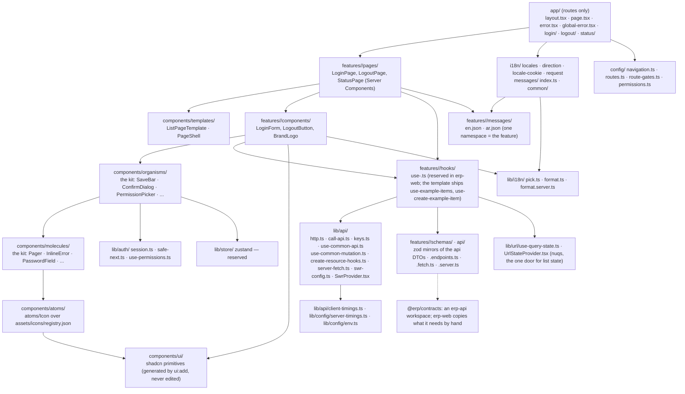
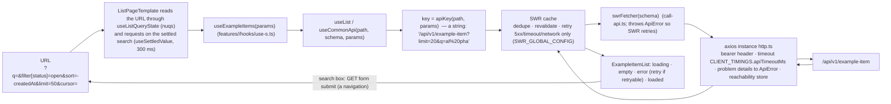
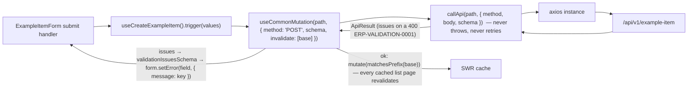
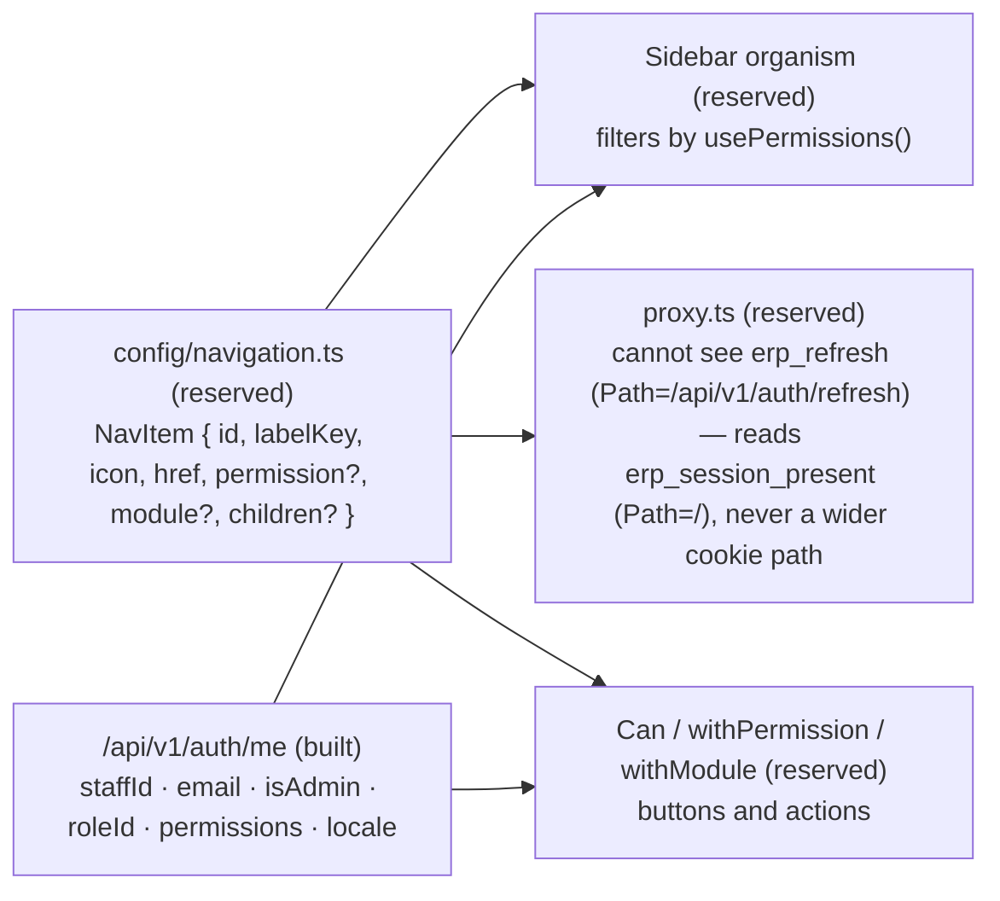

# Frontend components (C4 level 3): atomic design over a generic data layer

`erp-web` is a Next.js App Router application. Routes live in `app/` and contain no logic. Everything else lives under `src/` in layers that lint keeps one-directional: atoms never import organisms, features never import other features' internals, and only one file talks to axios. This page explains the layout the rules in `02-coding-rules/06-frontend.md` enforce, written from the code as built (the login page, `src/features/auth`, `src/features/branding`, `src/lib/api`); names in the diagrams are the built file names.

## Layer graph

Arrows point in the only allowed import direction. The graph is enforced by the `no-restricted-imports`/`no-restricted-syntax` scopes of erp-web `configs/eslint/frontend.mjs` (spread by its `eslint.config.mjs`), proven on every `check` by `corepack yarn check:arch`: `axios` is imported by `lib/api/http.ts` only (a type import in `call-api.ts` is the adapter seam), `swr` under `lib/api` only, and no file outside `components/atoms/Icon` imports `lucide-react` or renders an `<svg>`. Dashed: `@erp/contracts` is an erp-api workspace with no published package, so erp-web copies the schemas and the permission catalogue by hand.

## Layers as lint scopes

The architecture block is a set of disjoint flat-config scopes (S1–S12, S21, S22), each with ONE `no-restricted-imports` and ONE `no-restricted-syntax`, followed by seven single-purpose objects (S13–S19) that own other rule ids. The constants (`P_AXIOS`, `G_FEATURE_INTERNALS(f)`, `S_FETCH`, …) and the scope numbers are the citations every rule in `02-coding-rules/06-frontend.md` uses; the table is the per-place view.

| Place | May import | Never | Enforced by |
|---|---|---|---|
| `app/` | `next`, `next-intl`, `react`, `@/features/<m>` (index), `@/features/<m>/pages/*`, `@/features/<m>/api/*` (server helpers), `@/lib/**`, `@/components/**`, `@/i18n/**`, `@/messages/**` | a feature component, `callApi`, the instance or the SWR policy, axios, swr, lucide; `fetch`, `process.env`, `useEffect`, `Intl`, `<svg>`, a hex, a physical class | `P_AXIOS`, `P_SWR`, `P_LUCIDE`, `G_HTTP`, `G_CALL_API`, `G_FEATURE_COMPONENTS`, `S_ALL`, `S_UI` (S1); `src/__tests__/feature-shape.test.ts` `app/` clause |
| `features/<m>/pages` | its own feature, `@/features/<other>` (index only), `@/components/**`, `@/lib/**`, `@/i18n/**`, `@/messages/**` | another feature's internals, axios, swr, lucide, the instance | `P_AXIOS`, `P_SWR`, `P_LUCIDE`, `G_HTTP`, `G_FEATURE_INTERNALS(m)`, `S_ALL`, `S_UI` (S2) |
| `features/<m>/components` | as pages; `@/components/ui/*` directly; `@/lib/api/call-api` types | as pages; `useEffect`; inline `<svg>`, hex, physical classes (a 1:1 legacy glyph or colour carries a justified disable naming the view) | S2 (same entries); `react/jsx-no-literals` (S15); `jsx-a11y/*` (S19) |
| `features/<m>/hooks` | `@/lib/api/*` hooks, its own `api/` and `schemas/` | `useEffect`, axios, swr directly | S2; `src/__tests__/feature-shape.test.ts` (`use-*.ts`, test per file) |
| `features/<m>/api` | `@/lib/api/call-api`, `@/lib/api/server-fetch`, `@/lib/api/create-resource-hooks`, `zod` | axios, swr, `fetch` (except S3) | S2; S3 permits `fetch` in `legacy-handoff.ts` only |
| `features/<m>/schemas` | `zod` | anything with I/O | S2; `src/__tests__/feature-shape.test.ts` (kebab-case, test per file) |
| `features/<m>/messages` | — (JSON) | a key outside the grammar, an `ar` key absent from `en`, an `en` key referenced nowhere | `src/__tests__/feature-shape.test.ts` messages clause; `src/messages/__tests__/index.test.ts` |
| `components/ui` | — (generated) | a hand edit | `src/__tests__/feature-shape.test.ts` manifest clause; `corepack yarn ui:add`; `eslint.config.mjs` `ignores` |
| `components/atoms\|molecules\|organisms\|templates` | `@/components/ui/*`, the layers below, `@/lib/api/api-status` (stores), `@/lib/**` | a layer above, any feature, `callApi`, the instance, lucide and `<svg>` (except `atoms/Icon`) | `P_AXIOS`, `P_SWR`, `P_LUCIDE`, `G_HTTP`, `G_CALL_API`, `G_ANY_FEATURE`, `G_UPWARD(layer)`, `S_ALL`, `S_UI` (S8); S9 for `atoms/Icon` (no `P_LUCIDE`, no `S_SVG`) |
| `lib/api` | `axios` in `http.ts` only (S4); axios TYPES in `call-api.ts` (`P_AXIOS_TYPES`); `swr`, `swr/mutation` | a feature, a component, `fetch` (except `server-fetch.ts`), `process.env`, `useEffect` | `P_AXIOS_TYPES`, `P_LUCIDE`, `G_ANY_FEATURE`, `G_COMPONENTS_FROM_LIB`, `S_ALL`, `S_UI` (S5); S4 (`http.ts`), S7 (`server-fetch.ts`) |
| `lib/auth`, `lib/config`, `lib/i18n` | `zod`, `next-intl`, `server-only` | as `lib/api`; `process.env` outside `env.ts` (S6) | S5; S6 (`env.ts`: no `S_PROCESS_ENV`); S22 (the format doors: no `S_INTL`) |
| `lib/api/upload-file.ts` | `tus-js-client` (its one importer), `@/lib/auth/session`, the other `lib/api` files | axios, swr, nuqs, a feature, a component | S27 (the one scope without `P_TUS`); `P_TUS` in every other scope but S12; `corepack yarn check:arch` |
| `lib/hooks` | `react`, `@/lib/**` | a feature, a component, `fetch`, `process.env`, `Intl` | `P_AXIOS`, `P_LUCIDE`, `G_ANY_FEATURE`, `G_COMPONENTS_FROM_LIB`, `S_FETCH`, `S_PROCESS_ENV`, `S_INTL` (S10 — the one scope without `S_USE_EFFECT`) |
| `lib/log.ts` | `process.env.NODE_ENV` | `fetch`, `useEffect`, `Intl`, a feature | S21 (no `S_PROCESS_ENV`); `no-console` ignores it (S16) |
| `i18n/`, `messages/` | `next-intl/server`, `@/features/<m>/messages/*.json`, `@/features/branding/api/branding.server` | a feature component, `callApi`, axios, swr | `P_AXIOS`, `P_SWR`, `P_LUCIDE`, `G_HTTP`, `G_CALL_API`, `G_FEATURE_COMPONENTS`, `S_ALL`, `S_UI` (S11) |
| `test/`, `__tests__/`, `*.stories.tsx`, `.storybook/` | anything (`fetch`, axios fakes, `useEffect` in a decorator) | `process.env` | `S_PROCESS_ENV` only (S12); `vitest/*` (S18) |

## Data flow for one list screen

Reads never touch `callApi`; writes never go through `swrFetcher`. A write looks like:

`idempotencyKey` on `callApi` (a ULID per submit attempt, reused for a user-initiated retry) is not built: it arrives with the first money, stock or document POST, together with the api's interceptor (`02-coding-rules/05-backend.md` BE-15).

## State ownership ladder

Pick the highest rung that applies. Local component state is the last resort.

| Rung | Home | Holds | Example |
|---|---|---|---|
| 1 | URL (`useListQueryState` over `nuqs`, FE-15) | anything a user would share, bookmark, or expect after refresh | filters, sort, cursor, tab, open record, `?next=` |
| 2 | SWR (`useCommonApi`, `useList`, `createResourceHooks`) | server data | lists, records, `/me` |
| 3 | react-hook-form | form values, touched, errors | every form (`LoginForm`, `ExampleItemForm`) |
| 4 | Zustand (`lib/store`, reserved — built by the first preference that survives navigation) | global UI preferences and multi-step drafts, persisted per user | sidebar collapsed, density, wizard draft |
| 5 | `useState` / `useReducer` (≤ 3 per component file, clubbed) | ephemeral, truly local UI | `LoginForm`'s one `{ phase, message, code }`, a selected row |

Related state is clubbed into one `useState` object; derived values are computed in render; `useEffect` is allowed only in `src/lib/hooks/**` for the three cases listed in `02-coding-rules/06-frontend.md` FE-04 and must carry a `// effect: <kind>: <reason>` comment (`<kind>` is `subscribe`, `dom` or `analytics`). The banner's subscription to the reachability store is `useSyncExternalStore`, not an effect.

## Cross-cutting behaviour

There are exactly two homes for global behaviour, plus explicit invalidation:

| Concern | Home | Status |
|---|---|---|
| bearer header on every request, `timeout` from `CLIENT_TIMINGS`, problem details → `ApiError`, marking the api unreachable (503, timeout, network) | axios interceptors in `lib/api/http.ts` | built |
| retry policy for reads (3 × full jitter, never a 4xx), dedupe and focus throttle | `SWR_GLOBAL_CONFIG` mounted once by `SwrProvider` in `app/layout.tsx` | built |
| refreshing related data after a write | explicit `invalidate` prefixes on `useCommonMutation` | built |
| session bootstrap: one `fetchCsrf → refresh` per tab (single flight), serialised across tabs by the `erp-session-refresh` Web Lock | `use-session.ts`, started by `PageShell`, joined by `withAuth` (FE-16) | built |
| 401 → refresh on an expired access token | `use-session.ts` + `withAuth` (FE-16) | trigger: the first authenticated screen |
| 403 / 5xx toasts | shadcn `sonner` (FE-13) | trigger: the first non-field error on a non-form screen |
| client-side error reporting | `lib/logger/` over an api route (FE-13) | trigger: the first screen that must report a client failure; `log.warn`/`log.error` are the seam |

No frontend event bus, no Redux.

## Navigation, RBAC, and permalinks

`config/navigation.ts` will be the single source for the menu tree, icon names, routes, required permission and module; three consumers will read it so they cannot disagree. None of it exists yet: there is no authenticated erp-web screen and no shell — during coexistence the menu is the legacy system's and every migrated screen is a full page Nginx routes to web. The diagram is the contract; each box names its trigger in `02-coding-rules/06-frontend.md` FE-16.

Route shapes are fixed per resource (`/[module]/[resource]`, `/new`, `/[id]`, `/[id]/edit`, `/[id]/[tab]`), list and detail state lives in query params with the grammar shared with the API (`?q=&filter[field][op]=&sort=-field&limit=&cursor=`, cursor pagination as `02-coding-rules/05-backend.md` BE-19), and breadcrumbs plus the active menu item will be derived from the pathname against the navigation config. Details in `02-coding-rules/06-frontend.md` FE-15 and FE-16.

## Server and client components

| Use a Server Component when | Use a Client Component when |
|---|---|
| the page shell, a feature page (`LoginPage`, `StatusPage`), the first paint of a list or record that benefits from a server fetch | anything with SWR, forms, event handlers, browser APIs (`LoginForm`, `LogoutButton`, `ApiUnreachableBanner`) |
| reading branding and the locale per request (`getBranding()`, `src/i18n/request.ts`) | the `*List` and `*Form` components of a feature |

Server Components fetch through `serverFetchJson` (`lib/api/server-fetch.ts`) against `API_BASE_URL` with a `SERVER_TIMINGS` budget; they never call the database or bypass the API. Every route is dynamic today: `cookies()` runs in the request config for the locale, and the root layout fetches branding once per request (React `cache()`).

## i18n, RTL and brand

- **Messages** (`02-coding-rules/06-frontend.md` FE-19): next-intl without i18n routing; `src/features/<m>/messages/<locale>.json` per feature (namespace = the feature; legacy keys keep their `_lang.php` names), `src/messages/common/` for app words, `src/messages/index.ts` the registry (`messagesFor(locale)` deep-merges English first). The root layout's provider carries `common`; a page adds its own slice with `pick(await getMessages(), ['common', '<m>'])`. Keys come from the legacy packs one screen at a time; the packs stay out of git.
- **Direction** (FE-20): `app/layout.tsx` sets `lang` and `dir` once from `direction(locale)`; components use logical utilities only (`S_PHYSICAL` bans the physical ones); the locale is the `erp_locale` cookie → `branding.defaultLocale` → `en`, read only in `src/i18n/request.ts` and written by the browser after login.
- **Formatting** (FE-26): `useFormat()` / `getFormat()` with `FORMAT_DEFAULTS` — `date`, `dateTime`, `number` and `money` take the value only and render in the customer's Perfex formats from branding (`FormatSettingsProvider`), Latin digits under every locale, the customer's time zone with the deployment zone as the fallback.
- **Brand** (FE-17): nothing customer-specific in code; `getBranding()` once per request, `BrandLogo`, `themeCss` over `THEME_TOKENS` — `primary` and `radius` only, with both foregrounds computed for contrast and the meaning colours (destructive, success, ring, border, input) fixed — rendered as a `<style>` in the root layout; `corepack yarn check:brand` is the CI grep.

## Related decisions

- Rules: `02-coding-rules/06-frontend.md`; walkthrough: `01-onboarding/02-first-feature.md`; template: `05-templates/frontend-feature/README.md`.
