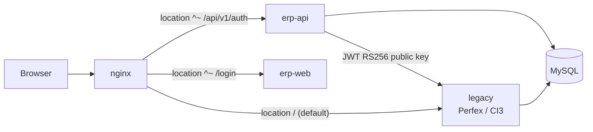

# Strangler fig: migrating module by module behind Nginx

Nginx is the only public entry. Each module moves to Node when it is ready, and Nginx sends that module's traffic to the Node stack while everything else still reaches the legacy system. The database is shared during the whole transition.

The legacy system is a customised Perfex CRM on CodeIgniter 3.1.11 with HMVC. Wherever this page says `legacy`, that is the container, the Nginx upstream and the `routing.yml` default.



## Order of migration

0. **Wave minus one: lift and shift.** Infrastructure only, no behaviour change. Move the legacy application and its database off shared cPanel hosting onto the dedicated VPS as a container, put our Nginx in front, and cut the domain over. Nothing else in this page is possible until we own the entry point. Rollback is a DNS revert.
1. **Wave 0: identity.** Login page in Next.js, auth module in Node issuing JWTs (`erp-api/src/v1/auth/`), the legacy app gets the JWT-validating `erp_sso` module. From here there is one login for the whole ERP; the attendance app's own API follows later.
2. **Wave 1: a small, read-mostly module** (for example master data) to prove the pipeline, the cutover checklist, and the parity tests.
3. **Following waves: by business value and by dependency.** A module moves after the modules it writes to, never before; the ownership register (below) makes this explicit.
4. **Last: retire the legacy system.** Remove the container, the default `location`, and the JWT middleware.

### Candidate cutover units

HMVC gives us the unit for free. `modules/` in the legacy tree holds 14 customer-specific modules, each with its own controllers, models and routes:

`accounting`, `backup`, `einvoice`, `exports`, `fixed_equipment`, `goals`, `hr_payroll`, `ideal`, `manufacturing`, `menu_setup`, `openai`, `quality`, `surveys`, `theme_style`

A further 94 controllers under `application/controllers/` are stock and customised Perfex (clients, invoicing, projects, staff). These are harder to carve up than the HMVC modules and are scheduled after them, except for the identity slice taken in wave 0.

The ordering within these waves is set per customer in the cutover tickets and is not fixed here.

## Nginx routing table format

The routing table lives in `erp-infra/customers/<customer>/<env>/routing.yml` and is rendered into the Nginx configuration by a renderer. Migrated modules are listed explicitly; the default goes to `legacy`.

Legacy URLs follow CodeIgniter's shape, not ours: `ADMIN_URL` is `admin` and `index_page` is empty, so staff screens are `/admin/<controller>/<method>`, the client area sits under its own prefix, and HMVC modules route under their module name. Our own endpoints keep the `/api/v1/<module>/*` prefix. The routing table therefore lists the new paths explicitly and lets every legacy shape fall through to the default.

```yaml
# routing.yml: one entry per migrated module. Anything not listed goes to legacy.
version: 3
default: legacy
api_prefix: /api/v1
modules:
  auth:        { api: node, ui: [/login, /logout, /forgot-password], since: 2026-11-01 }
  masterdata:  { api: node, ui: [/master], since: 2026-11-15 }
webhooks:
  - { provider: midtrans, target: node }   # webhooks move with the module that consumes them
```

`legacy_paths` lists the CodeIgniter URLs the module used to own. They are rendered as explicit `location` blocks pointing at the Node stack once the module is cut over, so that bookmarks and any legacy screen still linking to them follow the migration.

Every HMVC module appears under both `/<module>` and `/admin/<module>` because `MX_Router` strips the `admin` segment for module URLs.

Rendered shape (excerpt):

```nginx
# generated from routing.yml v3 — do not edit
upstream node_api  { server api:3000;  server api-2:3000; keepalive 32; }
upstream node_web  { server web:3000; }
upstream legacy    { server legacy:80; }

# Next.js assets and RSC payloads for every migrated page
location ^~ /_next/            { proxy_pass http://node_web; include snippets/proxy-common.conf; }
location ^~ /api/v1/webhooks/midtrans { proxy_pass http://node_api; include snippets/proxy-raw-body.conf; }
location /                     { proxy_pass http://legacy;  include snippets/proxy-common.conf; }
```

Rules: `^~` prefix matches so the migrated module wins over the default; one `location` per module for API, one per UI path, and one per retired legacy path; webhooks routed by provider; every change to `routing.yml` is a PR in `erp-infra` that references the cutover ticket. A UI path follows the menu the user clicks, not the module name, and a prefix never takes a path another system still serves: when a Node address moves, its old paths are redirected one location each. The web upstream always gets `/_next/` (and any `basePath`) in addition to its page paths, or the migrated page's assets fall through to legacy and it renders unstyled; `proxy-common.conf` forwards `Host $http_host` (with the port), not `$host`, because the legacy application builds its base URL from `HTTP_HOST` and every redirect would otherwise drop the port; both verified locally (`erp-infra/README.md`, "Verified on 2026-09-19").

As built locally (`erp-infra/nginx/local/default.conf`, hand-written until the renderer exists), the same shape with the scaffold routes, the wave-0 identity routes and a diagnostic header on every response (snippets omitted):

```nginx
upstream node_api { server api:3000; keepalive 32; keepalive_timeout 60s; }
upstream node_web { server web:3000; }
upstream legacy   { server legacy:80; }

location = /.well-known/jwks.json { add_header X-Erp-Route api always; proxy_pass http://node_api; }
location = /api/v1/auth/login     { limit_req zone=auth_login burst=20 nodelay; proxy_pass http://node_api; }
location ^~ /api/v1/              { add_header X-Erp-Route api    always; proxy_pass http://node_api; }
location =  /status               { add_header X-Erp-Route web    always; proxy_pass http://node_web; }
location =  /login                { add_header X-Erp-Route web    always; proxy_pass http://node_web; }
location =  /logout               { add_header X-Erp-Route web    always; proxy_pass http://node_web; }
location ^~ /_next/               { add_header X-Erp-Route web    always; proxy_pass http://node_web; }
location =  /admin/authentication { absolute_redirect off; if ($erp_login_redirect) { return 302 /login; } proxy_pass http://legacy; }
# wave 1 (W1-06): the Next.js staff and roles screens (under /setup since W2B-G), and Perfex's own paths for them
# server level, before any location: unwrap ONE CI3 alias (/index.php/<p>, /index.php?/<p>, /?/<p>) into <p>; a raw .. or a malformed query form -> 400 (quick 260929-hdy)
location =  /setup/staff          { add_header X-Erp-Route web    always; proxy_pass http://node_web; }   # + ^~ /setup/staff/, = /setup/roles, ^~ /setup/roles/; the old /staff and /roles answer 301 (W2B-G)
location =  /admin/staff/delete   { add_header X-Erp-Route legacy always; proxy_pass http://legacy; }     # + ^~ role_changed, ^~ remove_staff_profile_image
location ~* "^/admin/staff/change_staff_status" { add_header X-Erp-Route web always; default_type application/json; include snippets/refuse-identity-write.conf; }   # + ~* "^/admin/roles/delete"
location ~* "^/(?:admin/)?(?:fixed_equipment|…|warehouse)/(?:…/)?(?:update_permissions|…|delete_warehouse_permission)(?:/|$)" { … the same refusal … }
location ~  "^/admin/staff/?(?:index/?)?$"        { absolute_redirect off; add_header X-Erp-Route $erp_read_route   always; if ($erp_login_redirect) { return 302 /setup/staff; } proxy_pass http://legacy; }
location ~* "^/admin/staff/member/([0-9]+)(?:/|$)" { absolute_redirect off; add_header X-Erp-Route $erp_record_route always; if ($erp_login_redirect) { return 302 /setup/staff/$1; } if ($erp_identity_write) { include snippets/refuse-identity-write.conf; } proxy_pass http://legacy; }
location ^~ /erp_sso/             { add_header X-Erp-Route legacy always; proxy_pass http://legacy; }
location ^~ /api/auth/            { add_header X-Erp-Route legacy always; proxy_pass http://legacy; }   # + /api/attendance/, /api/face/
location ^~ /timesheets/api/      { return 410 '{"code":"ERP-LEGACY-0410","title":"This token issuer is switched off (ADR-0030)"}'; }
location /                        { add_header X-Erp-Route legacy always; proxy_pass http://legacy; }
```

`X-Erp-Route` makes the routing testable with `curl -sI`; it is diagnostic only and no client may act on it. `GET /admin/authentication` without `?legacy=1` is the Perfex staff login and goes to the Next.js page; `/admin/` without a session still answers Perfex's own 307 to that login. The api locations also include `snippets/proxy-api.conf` (`gzip off`, `Accept-Encoding` passed through).

### Wave 1: the staff and roles paths (W1-06)

The first migration of a screen the legacy system also **writes**, so it is the first routing table with more than two answers per path. Each row below is a `location` in `erp-infra/nginx/local/default.conf`; every one of them is proven on the wire by step 17 of `erp-infra/scripts/verify-wave0.mjs`.

| Perfex path | Plain `GET` (no `?legacy=1`) | `?legacy=1` | Any other method | `X-Erp-Route` |
|---|---|---|---|---|
| `/admin/staff`, `/admin/staff/`, `/admin/staff/index`, `/admin/staff/index/` | `302 /setup/staff` | legacy (read) | legacy: `Staff::index()` writes nothing and Perfex's own DataTable `POST`s here for its rows | `web` / `legacy` |
| `/admin/roles`, `/admin/roles/`, `/admin/roles/index`, `/admin/roles/index/` | `302 /setup/roles` | legacy (read) | legacy, for the same reason (`Roles::index()`) | `web` / `legacy` |
| `/admin/staff/member/<id>` | `302 /setup/staff/<id>` (regex capture, digits only) | legacy (read) | **`403 ERP-LEGACY-0403`** | `web` / `legacy` |
| `/admin/staff/member` | `302 /setup/staff/new` | legacy (read) | **`403`** | `web` / `legacy` |
| `/admin/roles/role/<id>` | `302 /setup/roles/<id>` | legacy (read) | **`403`** | `web` / `legacy` |
| `/admin/roles/role` | `302 /setup/roles/new` | legacy (read) | **`403`** | `web` / `legacy` |
| `/admin/staff/change_staff_status/<id>/<status>` | **`403`** | **`403`** | **`403`** | `web` |
| `/admin/roles/delete/<id>` | **`403`** | **`403`** | **`403`** | `web` |
| the seven modules' 15 permission-write methods, in all four CI3 URL forms | **`403`** | **`403`** | **`403`** | `web` |
| `= /admin/staff/delete`, `/admin/staff/role_changed*`, `/admin/staff/remove_staff_profile_image*` | legacy | legacy | legacy | `legacy` |
| the modules' `permission_modal`, `*_permission_table`, `role_changed`, `hr_role_changed` | legacy | legacy | legacy | `legacy` |
| any row above, in any letter case (except the two list rows, which refuse nothing and stay case-sensitive, so a case variant reaches Perfex as a read) or behind `/index.php/`, `/index.php?/`, `/?/` or `/index.php/?/` | as that row | as that row | as that row | as that row |
| a raw `..` segment, or an empty, `.` or `..` segment in the query form | **`400`** | **`400`** | **`400`** | `web` |

Four rules this wave establishes for every later one:

- **A retired write path is refused, never rewritten.** Proxying a form `POST` to `node_web` answers with Next's 404 page, which reads as "the page moved" rather than "your change was refused"; redirecting one makes the browser re-issue it as a `GET`, so the write silently does not happen and the screen looks like it succeeded. Both are a write that did not happen and nobody was told. The refusal is one `include snippets/refuse-identity-write.conf` — `403` with `{"code":"ERP-LEGACY-0403",…}` — so an AJAX caller can tell a refusal from a page.
- **The method is part of the routing decision, and `location` cannot express it.** It comes from `map`s keyed on `$request_method$arg_legacy` (the shape the login redirect introduced). A write is decided by the **method alone**, so `?legacy=1` cannot reopen one and `?legacy=0` cannot close a read.
- **Closing a write path means listing the sibling reads that must not move.** `/admin/staff/role_changed` is read-only and is called by the seven modules' permission modals; `/admin/staff/remove_staff_profile_image` writes files on Perfex's disk; `/admin/staff/delete` writes about 40 tables Node does not own. All three keep exact or `^~` blocks **above** the redirect regexes, and the wire proof asserts each of them still answers `legacy`.
- **A closed path is closed under every URL CI3 routes to it.** PHP method names are case-insensitive and CI3 routes `/index.php/<p>`, `/index.php?/<p>` and `/?/<p>` to `<p>` and drops raw `..` segments, so a case-sensitive `^~` refusal was reachable from Perfex (found 2026-09-29). The server unwraps one alias before choosing a location, so every block applies to the alias without its own `index.php` prefix; every refusal is `~*`; a nested alias is left for Perfex to answer as before; `verify-wave0.mjs` 17m to 17t prove each form without a session.

### Wave 2a: the Setup lists (W2A-01 pilot, W2A-02 Taxes, W2A-03 Cost Centers, W2A-04 Payment Modes, W2A-05 Currencies)

The first Setup list, Expense Categories, is routed by the W2A-01 section of `erp-infra/nginx/local/default.conf`, and its rows below are proven on the wire by step 20 of `erp-infra/scripts/verify-wave0.mjs` (20a to 20g). Taxes is routed by the W2A-02 section, right after it, and its rows are proven by step 22 (22a to 22g; step 21 is quick 261001-m42's). Cost Centers is routed by the W2A-03 section, right after W2A-02, and its rows are proven by step 24 (24a to 24g). Payment Modes is routed by the W2A-04 section, right after W2A-03, and its rows are proven by step 27 (27a to 27g; step 26 is the Email screens). Currencies is routed by the W2A-05 section, right after W2A-04, and its rows are proven by step 29 (29a to 29g).

| Perfex path | Plain `GET` | `?legacy=1` | Any other method | `X-Erp-Route` |
|---|---|---|---|---|
| `/admin/expenses/categories`, `/admin/expenses/categories/` | `302 /setup/expense-categories` (`HEAD` too; relative, the query dropped) | as a plain `GET` (no escape) | legacy: Perfex's own DataTable `POST`s here for its rows, a read | `web` / `legacy` |
| `/admin/expenses/delete_category/<id>` | **`403 ERP-LEGACY-0403`**, `managedAt` `/setup/expense-categories` | **`403`** | **`403`** | `web` |
| `= /admin/expenses/category` (the expense form's inline "+": add and edit share the URL) | legacy | legacy | legacy: a recorded co-writer | `legacy` |
| `/admin/timesheets/add_expense_category`, in its four MX URL forms | legacy | legacy | legacy: a recorded co-writer, through `location /` | `legacy` |
| `/setup/expense-categories`, `/setup/expense-categories/new`, `/setup/expense-categories/<id>` | web (`proxy.ts` sends a visitor without a session to `/login?next=`) | web | web | `web` |
| `/admin/taxes`, `/admin/taxes/`, `/admin/taxes/index`, `/admin/taxes/index/` | `302 /setup/taxes` (`HEAD` too; relative, the query dropped) | as a plain `GET` (no escape) | legacy: Perfex's own DataTable `POST`s here for its rows, a read | `web` / `legacy` |
| `/admin/taxes/manage` (Perfex's add and edit share it), `/admin/taxes/delete/<id>`: any path beginning with either | **`403 ERP-LEGACY-0403`**, `managedAt` `/setup/taxes` | **`403`** | **`403`** | `web` |
| `/admin/taxes/tax_name_exists` (Perfex's name check, a read) | legacy | legacy | legacy, through `location /` | `legacy` |
| `/admin/subscriptions...` (Subscriptions inserts a tax for a Stripe rate with no matching row) | legacy | legacy | legacy: a recorded co-writer; nothing in the section matches it | `legacy` |
| `/setup/taxes`, `/setup/taxes/new`, `/setup/taxes/<id>` | web (`proxy.ts` sends a visitor without a session to `/login?next=`) | web | web | `web` |
| `/admin/cost_centers`, `/admin/cost_centers/`, `/admin/cost_centers/index`, `/admin/cost_centers/index/` | `302 /setup/cost-centers` (`HEAD` too; relative, the query dropped) | as a plain `GET` (no escape) | legacy: Perfex's list is an inline table with no DataTable `POST`, so a non-`GET` here is a read | `web` / `legacy` |
| `/admin/cost_centers/create`, `/admin/cost_centers/edit/<id>`, `/admin/cost_centers/delete/<id>`: any path beginning with one of the three | **`403 ERP-LEGACY-0403`**, `managedAt` `/setup/cost-centers` | **`403`** | **`403`** | `web` |
| the readers of `tblcost_centers`: the expense form, `fixed_equipment`'s asset creation | legacy | legacy | legacy; none is under `/admin/cost_centers`, so nothing in the section matches them | `legacy` |
| `/setup/cost-centers`, `/setup/cost-centers/new`, `/setup/cost-centers/<id>` | web (`proxy.ts` sends a visitor without a session to `/login?next=`) | web | web | `web` |
| `/admin/paymentmodes`, `/admin/paymentmodes/`, `/admin/paymentmodes/index`, `/admin/paymentmodes/index/` | `302 /setup/payment-modes` (`HEAD` too; relative, the query dropped) | as a plain `GET` (no escape) | legacy: Perfex's own DataTable `POST`s here for its rows, a read | `web` / `legacy` |
| `/admin/paymentmodes/manage` (Perfex's add and edit share it), `/admin/paymentmodes/delete/<id>`, `/admin/paymentmodes/change_payment_mode_status/<id>/<status>`, `/admin/paymentmodes/change_payment_mode_show_to_client_status/<id>/<status>`: any path beginning with one of the four | **`403 ERP-LEGACY-0403`**, `managedAt` `/setup/payment-modes` | **`403`** | **`403`** | `web` |
| the readers of `tblpayment_modes`: invoices and record payment, payments, the expense form, credit notes, the payment-modes report, accounting's mapping, `fixed_equipment`'s orders, exports | legacy | legacy | legacy; none is under `/admin/paymentmodes`, so nothing in the section matches them | `legacy` |
| `/setup/payment-modes`, `/setup/payment-modes/new`, `/setup/payment-modes/<id>` | web (`proxy.ts` sends a visitor without a session to `/login?next=`) | web | web | `web` |
| `/admin/currencies`, `/admin/currencies/`, `/admin/currencies/index`, `/admin/currencies/index/` | `302 /setup/currencies` (`HEAD` too; relative, the query dropped) | as a plain `GET` (no escape) | legacy: Perfex's own DataTable `POST`s here for its rows, a read | `web` / `legacy` |
| `/admin/currencies/manage` (Perfex's add and edit share it), `/admin/currencies/delete/<id>`, `/admin/currencies/make_base_currency/<id>` (the star link, a `GET`): any path beginning with one of the three | **`403 ERP-LEGACY-0403`**, `managedAt` `/setup/currencies` | **`403`** | **`403`** | `web` |
| `/admin/currencies/get_currency_symbol/<id>` (Perfex's symbol lookup on the same controller, a read) | legacy | legacy | legacy, through `location /`: no location of the section names it | `legacy` |
| the readers of `tblcurrencies`: invoices, estimates, proposals, expenses, credit notes, subscriptions, customers, reports, `/admin/misc/get_currency`, accounting, `fixed_equipment`, `hr_payroll`, exports | legacy | legacy | legacy; none is under `/admin/currencies`, so nothing in the section matches them | `legacy` |
| `/setup/currencies`, `/setup/currencies/new`, `/setup/currencies/<id>` | web (`proxy.ts` sends a visitor without a session to `/login?next=`) | web | web | `web` |
| any row above behind `/index.php/`, `/index.php?/`, `/?/` or `/index.php/?/` (the server's alias block unwraps it first), and each refusal in any letter case (`~*`); the five list rows stay case-sensitive (`~`), so `/admin/expenses/CATEGORIES`, `/admin/Taxes`, `/admin/taxes/index/<x>`, `/admin/Cost_centers`, `/admin/cost_centers/index/<x>`, `/admin/PaymentModes`, `/admin/paymentmodes/index/<x>`, `/admin/Currencies` and `/admin/currencies/index/<x>` reach Perfex as a read | as that row | as that row | as that row | as that row |

What differs from W1-06: no `?legacy=1` escape on the list, so its maps are keyed on `$request_method` alone; the refusal is the shared `snippets/refuse-legacy-write.conf`, whose caller sets `$erp_managed_at` to the list's Node path, so one snippet serves every Setup list; and only the delete is closed, because the two other Perfex writers of the table stay open until Expenses and Timesheets migrate. `/admin/expenses`, `/admin/expenses/expense` and `/admin/accounting/expense_category_mapping` match nothing in the section and stay on Perfex.

What W2A-02 adds: nothing new in the shape. It reuses the two method maps and the shared snippet, and its list regex takes Perfex's `index` method forms, as W1-06's list does. Its refusal closes Perfex's manage and delete together, because the one other live writer of `tbltaxes`, Perfex core Subscriptions, writes from `/admin/subscriptions` and never through them. `fixed_equipment`'s writer has no caller, so nothing can reach it. Node does not write `tbloptions.default_tax`, so it refuses to change a tax Perfex names there (see "Temporary restrictions to lift").

What W2A-03 adds: nothing new in the shape. It reuses the two method maps and the shared snippet, and its list regex takes the `index` forms, as W2A-02's does. Its refusal closes all three of Perfex's write methods, create, edit and delete, because the screen is the table's one writer. Cost Centers stays a Main Menu item, not a Setup item, with its page under `/setup`. Every reader stays on Perfex; the delete-in-use check counts the referencing columns the connected schema has, found at runtime.

What W2A-04 adds: nothing new in the shape. It reuses the two method maps and the shared snippet, and its list regex takes the `index` forms, as W2A-02's and W2A-03's do. Its refusal closes four methods: manage (Perfex's add and edit), delete, and the two toggles, `change_payment_mode_status` (the list's Active switch, which Node answers with its own one-click switch) and `change_payment_mode_show_to_client_status`, which no screen calls and whose `showtoclient` column no migration creates. No co-writer exists: Perfex's screen was the table's one writer, and it was administrator-only already (`Paymentmodes.php:11`), so no user loses a path. Every reader stays on Perfex; the delete-in-use check counts the eight transactional payment and refund columns the connected schema has, found at runtime and compared as exact text, and Node refuses to delete the mode Perfex's `expense_credit_payment_mode` names (see "Temporary restrictions to lift").

What W2A-05 adds: nothing new in the shape. It reuses the two method maps and the shared snippet, and its list regex takes the `index` forms. Its refusal closes three methods: manage (Perfex's add and edit), delete and `make_base_currency`, one of them a `GET` link (the star; the delete is a link too), and a read helper on the same controller, `get_currency_symbol`, is asserted open (step 29f). No co-writer exists: Perfex's screen was the table's one writer, and it was administrator-only already (`Currencies.php:11`), so no user loses a path. Every reader stays on Perfex. It is the first list with one reference register of three match kinds, an integer id, an id as text and a code as text, discovered at runtime; whose delete also asks the uses other modules register through `CurrenciesFacade.registerUsage`; whose change publishes events another module subscribes to (branding drops its memo on `currencies.record.baseChanged` and `.updated`); whose base changes only on Perfex's rule, while the current base has no transaction in Perfex's seven core columns; and whose code cannot change while anything uses the currency, a register line or a registered use, because past records would show another code (409 `ERP-CURRENCIES-0005`). That rename rule is permanent: no later migration undoes what a past document shows, so it is not a coexistence restriction and has no "Temporary restrictions to lift" row.

### Wave 2c: the Email screens

The shared mail sender adds five Node screens and moves no Perfex path. They are routed by the W2C section of `erp-infra/nginx/local/default.conf`, before `location ^~ /erp_sso/` and `location /`, and proven on the wire by step 26 of `erp-infra/scripts/verify-wave0.mjs` (26a to 26e; 26e sends one status test through Nginx to the local Mailpit and runs only when the target row is an administrator).

| Path | Plain `GET` | `?legacy=1` | Any other method | `X-Erp-Route` |
|---|---|---|---|---|
| `/setup/email-templates` (`=`), `/setup/email-templates/<id>` (`^~ /setup/email-templates/`) | web (`proxy.ts` sends a visitor without a session to `/login?next=`) | web | web | `web` |
| `/setup/sent-emails` (`=`), `/setup/sent-emails/<id>` (`^~ /setup/sent-emails/`) | web (administrators only) | web | web | `web` |
| `/setup/email-status` (`=` only: `/setup/email-status/<x>` falls to `location /`) | web (administrators only) | web | web | `web` |
| `/admin/emails`, `/admin/settings?group=email` (Perfex's own Email Templates and SMTP settings) | legacy, unchanged: never refused, never redirected | legacy | legacy | `legacy` |
| `/api/v1/mail/*` (the thirteen handlers of `v1/mail`) | api, through `^~ /api/v1/` | api | api | `api` |

What W2C adds: nothing in the shape, and no method map. Every location is `=` or `^~` under `/setup/`, a prefix no Perfex path uses, so no Perfex path moves and nothing is refused: Perfex's `/admin/emails` keeps sending its own templates, and its SMTP settings stay Perfex's, while Node's SMTP settings live in the deployment env. No table changes owner in this phase: the three tables (`tblmail_templates`, `tblmail_template_versions`, `tblmail_sent_emails`) are Node-created by `prisma/sql/0004-mail.sql` and registered `node` in erp-api `prisma/ownership-node.json`; Perfex's `tblemailtemplates` is read once per key to seed and `tblmail_queue` is never read.

## Table ownership register

The register lives in machine-readable form at `erp-api/prisma/ownership.json` so CI can check it. Every table has exactly one writer at any time.

The register holds 403 tables, all prefixed `tbl`; the client's latest dump (the one `erp-infra/legacy-local` loads and `erp-api/prisma/schema.prisma` mirrors) has 409, and the 6 not yet in the register are listed in `erp-api/prisma/INTROSPECTION.md` until a slice needs them (`tblasset_code_requests`, the seventh, was seeded through `schemaExtraTables`). Most custom modules carry their own prefix (`tblacc_*` accounting, `tblhrp_*` payroll), which makes the per-module slice mostly mechanical. Stock Perfex tables do not, and are the ones to read carefully.

| Table | Owner now | Owner after cutover | Node access during coexistence | Notes |
|---|---|---|---|---|
| `tblstaff` | Node (wave 0) | Node | write (identity columns: password, last_login, last_ip) | Perfex still writes profile/activity columns during coexistence: a recorded exception, not a second owner. After W1-06 the remaining Perfex writers are named and few: the member's own profile pages (`edit_profile`, `change_password_profile`, `change_language`, two-factor), `remove_staff_profile_image` and `staff/delete`. The **administrator flag** cannot be set from any core Perfex path (`is_admin()` gates it inside the model) |
| `tblroles`, `tblstaff_permissions` | Node (wave 1) | Node | write, `v1/identity` only (`tblstaff_permissions` via `$executeRaw`, it has no primary key so Prisma `@@ignore`s it) | granting is admin-only and audited (d.3). **W1-06 closed most of the co-writers:** Perfex's core screens and the seven modules' 15 permission-write endpoints are refused at Nginx (`403 ERP-LEGACY-0403`). Their permission modals still open: the reads beside those writes are untouched. |
| `tblstaff_departments` | Node (wave 1) | Node | write, `v1/identity` only | written by the member screen |
| `tblexpenses_categories` | Node (wave 2a) | Node | write, `v1/expense-categories` only | written by the Setup screen (`/setup/expense-categories`); Perfex keeps reading it (the expense forms' Category select). The expense form's inline add (`POST /admin/expenses/category`) and the timesheets add (`/admin/timesheets/add_expense_category`, through `Expenses_model::add_category`) stay recorded co-writers until Expenses and Timesheets migrate; a category added there publishes no Node event. Perfex's delete is refused at Nginx (`403 ERP-LEGACY-0403`). Node writes no `tblactivity_log` row |
| `tbltaxes` | Node (wave 2a) | Node | write, `v1/taxes` only | written by the Setup screen (`/setup/taxes`); Perfex and its modules keep reading it (every tax select, the line tables that name tax ids). Perfex core Subscriptions' insert of a tax for an unmatched Stripe rate (`application/models/Subscriptions_model.php:161`) stays a recorded coexistence co-writer until Subscriptions migrates; such a row publishes no Node event. `fixed_equipment`'s writer (`modules/fixed_equipment/models/Fixed_equipment_model.php:9745`, `:9753`) is unreachable: the two-argument `get_tax_by_name` that leads to it has no caller. Perfex's manage and delete are refused at Nginx (`403 ERP-LEGACY-0403`). Node writes no `tblactivity_log` row and refuses to change a tax named in `tbloptions.default_tax` rather than rewrite that setting. The flip closed one open ownership record, so the ratchet is 76 (was 77) |
| `tblcost_centers` | Node (wave 2a) | Node | write, `v1/cost-centers` only | written by the Cost Centers screen (`/setup/cost-centers`, a Main Menu item); Perfex and its modules keep reading it (the expense form, `fixed_equipment`'s asset creation). No co-writer: Perfex's own screen was the one writer, and its create, edit and delete are refused at Nginx (`403 ERP-LEGACY-0403`). A delete is refused while the cost center is in use, counted over the referencing columns discovered at runtime: `fixed_equipment` names it by its text, not its id, and the expense and shipping-charge columns, absent locally, are counted once their slices add them. Node writes `created_by` and `datecreated` on create as Perfex does, the signed-in staff id and Perfex's wall clock in `default_timezone`, and never changes them on edit. Node writes no `tblactivity_log` row. A write-single record, so the ratchet is unchanged at 68 |
| `tblpayment_modes` | Node (wave 2a) | Node | write, `v1/payment-modes` only | written by the Payment Modes screen (`/setup/payment-modes`, Setup > Finance); Perfex and its modules keep reading it (invoices and payments, the expense form, credit notes, reports, accounting, `fixed_equipment`, exports). No co-writer: Perfex's own screen was the one writer, and its four write paths (manage, delete and the two toggles) are refused at Nginx (`403 ERP-LEGACY-0403`). A delete is refused while any of eight transactional payment and refund columns names the mode as exact text, counted over the columns discovered at runtime, or while Perfex's `expense_credit_payment_mode` option names it (409 `ERP-PAYMENTMODES-0002`); switching a mode off stays allowed. The description is stored as Perfex stores it (`nl2br_save_html`), so Perfex's PDFs and screens show it unchanged. Node writes no `tblactivity_log` row. A write-single record, so the ratchet is unchanged at 67 |
| `tblcurrencies` | Node (wave 2a) | Node | write, `v1/currencies` only | written by the Currencies screen (`/setup/currencies`, Setup > Finance); Perfex and its modules keep reading it (invoices, estimates, proposals, expenses, credit notes, subscriptions, customers, reports, accounting, `fixed_equipment`, `hr_payroll`, exports). No co-writer: Perfex's own screen was the one writer, and its three write paths (manage, delete and `make_base_currency`) are refused at Nginx (`403 ERP-LEGACY-0403`). The base (`isdefault`) changes only on Perfex's rule, while the current base has no transaction in Perfex's seven core columns, one row set and the others cleared in one transaction; branding reads the base through `CurrenciesFacade` and drops its memo on `currencies.record.baseChanged` and `.updated`. A delete is refused while an id line of the one reference register (integer ids and ids as text, counted over the columns discovered at runtime; the exchange rates and their logs never), the base or a registered use holds the currency; a code change is refused while any of them does, a code line included (permanent). Node writes no `tblactivity_log` row. A write-single record, so the ratchet is unchanged at 67 |
| `tbldepartments` | legacy (perfex-core) | — | read-only, `v1/departments` only, six columns: `departmentid`, `name`, `hidefromclient`, `calendar_id`, `manager_id`, `parent_id` | written by Perfex's own Departments screen (`/admin/departments`; the Setup > Support > Departments item opens it) and by hr_profile's org chart (the manager and the parent); Node has no Departments page and no write route. `v1/departments` serves the reads (list, export, the manager and parent pickers, the record) and the facade identity uses: identity reads its department picker and checks a member's new department ids through `DepartmentsFacade`, and registers its staff-member counter and staff directory with it. `department-columns.spec.ts` fails any write to the table and any `tbldepartments` call off the six-column allow-list |
| `tblcustomfields` | legacy (perfex-core) | — | read-only, `v1/custom-fields` only | written by Perfex's own Setup > Custom Fields page (`/admin/custom_fields`; the Setup > Custom Fields item opens it) and by warehouse's `wh_convert_to_customer`; Node has no Custom Fields page and no write route. `v1/custom-fields` serves the reads (list, export, record) and the read facade (`definitionsFor`) |
| `tblcustomfieldsvalues` | legacy (perfex-core) | — | read-only, `v1/custom-fields` only | written by Perfex core's `handle_custom_fields_post` for every core entity, and by purchase and warehouse; Node reads the values through the facade (`valuesFor`) and counts them per field |
| `tblcontact_permissions` | legacy (perfex-core) | Node (clients wave) | read-only | Perfex's client-contact permissions; untouched by wave 1 |
| `tbldismissed_announcements` | legacy (perfex-core, decided 2026-10-09) | perfex-core (core's announcements) | none: Node never writes it | written by core's announcements, staff and contacts code. The decision closed one UNATTRIBUTED record, so the ratchet moved 56 -> 55 in the same commit |
| `tblacc_*` | legacy | Node (accounting wave) | none until cutover | written only by accounting |
| stock Perfex tables (clients, invoicing, projects) | legacy | Node (late waves) | read-only | entangled with custom modules; check writers before claiming ownership |

Rules during coexistence:

- **One writer per table.** `ownership.json` lists `owner: node | legacy` per table. A Prisma write to a `legacy`-owned table fails a CI check (schema diff against ownership) and, as a second line, a Prisma middleware in `dev`/`uat` rejects it at runtime.
- **No dual writes.** If a feature needs both systems to write the same rows, the module is not ready; either move the whole write path or put a queue between them with Node as the writer.
- **Read-only mirrors are fine.** Node reads legacy-owned tables through Prisma models introspected from the existing schema; those models are excluded from Prisma migrations until cutover.
- **Schema changes on legacy-owned tables arrive from the vendor, not from us.** Perfex ships its own CodeIgniter migrations (`application/migrations/`, currently at `340_version_340.php`). We do not author them and cannot review them in a PR. **Product upgrades are frozen for the duration of coexistence**. If a security fix forces one, it is a planned event: re-introspect the schema, re-run the ownership check, re-run parity tests, then apply. After ownership transfers, changes happen only in Prisma migrations.
- **Cross-module writes go through facades,** never through another module's tables, so ownership can transfer one module at a time.

## Per-module cutover checklist

Copied into the cutover ticket and ticked in order. Items reference the rule or doc that defines them.

1. **Scope frozen.** Endpoints, screens, tables, jobs, events, and webhooks of the module listed in its README; ownership register entries drafted; the module's legacy URLs recorded for `legacy_paths`.
2. **Parity tests green.** Recorded legacy responses replayed against Node for every endpoint (golden files in `test/parity/<module>/`); differences are either fixed or documented as intentional in the ticket. The legacy system's own JWT API and `API_DOCUMENTATION.md` are the contract where the module has one.
3. **Data ownership transferred in a migration PR.** `ownership.json` updated; Prisma migrations for the tables enabled; legacy writes to those tables removed or redirected (the legacy app calls Node's API for the rare write it still needs, with a transport adapter on the Node side for the reverse direction).
4. **Cache and jobs.** Module's repeatable jobs registered in the worker; the legacy cron entries for the same work disabled in the same deploy. The loose integration scripts at the legacy web root (`sync_hikvision_attendance.php`, `sap_import_*.php`, `generate_accounting_entries_live.php`, `pipe.php`) are cron-driven and must be checked against every module's scope. The schedules the tree cannot supply are filled in by hand, and a job whose schedule is still `unknown` blocks this step.
5. **Routing PR ready** in `erp-infra` (`routing.yml` entries for API, UI, `legacy_paths`, and webhooks) with the rollback commit prepared (the previous `routing.yml`).
6. **Observability.** Dashboard panel for the module's error rate, p95, and DLQ depth; alert thresholds set.
7. **Deploy to `uat`,** run the parity suite against the routed environment, get business sign-off on the module's screens.
8. **Deploy to `prod`** using blue/green for the Node stack, then merge the routing PR. Watch the dashboard for the agreed soak period.
9. **Close.** Legacy code for the module marked deprecated (not deleted until retirement); README updated with `migrated_on`.

## Rollback

Rollback is a routing change, not a code change:

1. Revert the `routing.yml` PR in `erp-infra` (one commit), push to the environment branch; Nginx reloads within seconds and the module's traffic returns to the legacy system.
2. If ownership transferred and Node wrote data the legacy system must see: Node-owned tables were still the same physical tables, so the legacy app reads them unchanged. If a Prisma migration altered a table shape, run the prepared down migration listed in the cutover ticket before reverting routing.
3. Re-enable the legacy cron entries disabled in step 4 of the checklist.
4. Record the rollback reason in the ticket.

The cutover ticket is not closed until the rollback path has been rehearsed once in `uat`.

## Coexistence contract with the legacy system

| Concern | Rule |
|---|---|
| Identity | Node issues RS256 JWTs; the legacy app validates with the public key (`/.well-known/jwks.json` on the Node API) and maps `sub` to its active staff row. Delivered as the Perfex module `erp_sso` (`erp-infra/legacy/modules/erp_sso/`), overlaid locally by a read-only bind mount, uploaded and activated on cPanel — no core file edited. `firebase/php-jwt` 5.x is already vendored at `application/third_party/php-jwt/`, so it is a module, not a new dependency |
| Existing legacy tokens | The core HS256 issuer (`APP_ENC_KEY`, 7-day expiry) is retained for the attendance app until it migrates to Node, with its routes `/api/auth/*`, `/api/attendance/*`, `/api/face/*` routed to legacy explicitly in Nginx; the `timesheets` module's issuer answers 410 from Nginx now. Node accepts neither |
| Passwords | Perfex hashes passwords with bcrypt. Node's `bcryptjs` verifies any bcrypt label; wave 0 re-hashes to `$2y$12$` on successful login by compare-and-set, and PHP `crypt()` accepts that value (verified in the legacy image) |
| Sessions | Legacy CodeIgniter sessions (`sp_session`) stay legacy-owned for unmigrated screens; the login page is Next.js from wave 0 and sets the three Node cookies (`erp_refresh`, `erp_csrf`, `erp_session_present`) and a legacy session through the one-time `POST /erp_sso/handoff` of the `erp_sso` module (204 on success) |
| Calls Node to legacy | only through a legacy adapter behind a port, with an anti-corruption transformer; removed at retirement |
| Calls legacy to Node | only over the public API with a service token; no direct DB writes into Node-owned tables |
| Files and uploads | move to the storage port on the module's cutover; until then the legacy `uploads/` path is proxied |
| Reports spanning both | read-only SQL views over shared tables, owned by Node, removed when the last source table migrates |

## Temporary restrictions to lift

A restriction or workaround that exists only because the legacy system still runs beside Node. Each row names the migration that removes it. Whoever writes the brief or the plan of the module in **Lift when** reads this table first and plans the lift in that slice; the lift then deletes its row here.

| Restriction | Why it exists | Lift when | Decided in |
|---|---|---|---|
| Node refuses to change the name or rate of a tax named in Perfex's default taxes (409 `ERP-TAXES-0004`; the form opens it read-only) | Perfex keeps the default taxes as `name\|rate` text in `tbloptions.default_tax` and rewrites it on a tax edit (`application/models/Taxes_model.php:86-101`); Node never writes `tbloptions` | Perfex's settings (`tbloptions`, at least `default_tax`) move to Node with write access; the read-only settings facade is not enough | |
| Node refuses to delete the payment mode Perfex's `expense_credit_payment_mode` option names (409 `ERP-PAYMENTMODES-0002`); switching it off stays allowed | the client's customised expense code reads that option as the credit-expense mode (`application/models/Expenses_model.php:109`), no Perfex screen writes it, and Node never writes `tbloptions` | Perfex's settings (`tbloptions`, at least `expense_credit_payment_mode`) move to Node with write access and Expenses migrates, so a delete can re-point or clear the option in the same change | |
| Perfex core Subscriptions may insert into Node-owned `tbltaxes` (a Stripe tax rate with no matching row); such a row publishes no Node event | a live Perfex flow (`application/models/Subscriptions_model.php:143-165`); refusing it would break subscriptions | Subscriptions moves to Node: create the tax through the Taxes module, then remove the co-writer from the register | |
| Perfex's expense form inline "+" (`POST /admin/expenses/category`) and `/admin/timesheets/add_expense_category` may write Node-owned `tblexpenses_categories`; such a row publishes no Node event | live Perfex flows; the inline add shares its URL with the edit, so Nginx cannot refuse one without the other | Expenses moves to Node (the inline add); timesheets moves to Node (its add path) | |
| Every export list shows to whoever may view the list; Perfex's `show_table_export_button` setting (everyone, administrators only, hidden) is not honoured | the setting lives in `tbloptions`, which Node reads only through the read-only settings facade's allow-list (`v1/settings`), and the key is not on it | a plan adds the key to the facade's allow-list and honours it in the kit | deferred |
| Node reads 95 `tbloptions` keys (the settings facade's allow-list, `v1/settings`) and saves only its recorded co-writes; branding settings are changed on Perfex's Settings screen | `tbloptions` stays `unattributed` with eight legacy writers; `v1/settings` is the only Node reader besides `v1/taxes`' `default_tax` read | the settings module moves to Node with write access | |
